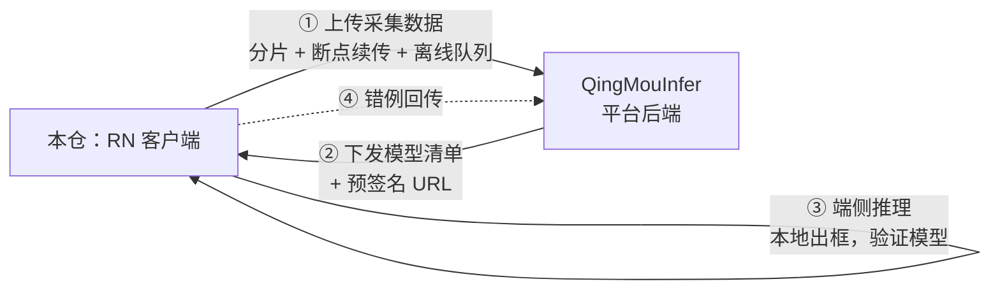

# QingMouCollection · 轻眸识刻采集客户端

> 去现场把数据拍回来，顺便在手机上当场看看模型到底行不行。

本仓是 [轻眸识刻](https://github.com/QingMouFoodDate/QingMouPRD) 的 **React Native 客户端**。
它是整个项目里**唯一一个会被带到现场去的软件**。

---

## 我们在做什么

我们想做一个「拍张照就能读出食品生产日期」的模型。

这件事卡在最前面的地方很反直觉：**不是算法难，是没有数据。**

你买不到「各种喷码字体、各种包装曲面、各种货架光照」的日期照片数据集。这东西不存在于任何公开数据集里，只能自己去拍——去仓库、去货架、去流水线旁边，一张一张地拍。

而"去现场拍"这件事，落到具体的人身上是这样的：

> 人站在货架前，一只手拿着包装盒调整角度，另一只手举着手机。仓库里没有信号，拍完的照片传不出去，只能先存在手机里。回到办公室才发现，有一半照片糊了、有三分之一拍的是同一个盒子、还有几张根本没拍到日期。

这个仓就是为了让上面这句话里的每一个麻烦都不成立。

---

## 现场是什么样的

理解这个仓的设计，得先理解现场：

**没网是常态，不是异常。** 地下仓库、冷库、工厂车间——这些地方经常完全没有信号。所以「拍摄」和「上传」必须是两件彻底分开的事：拍摄只管往手机本地写，上传是一个独立的后台任务，有网了自己补上去。**现场无网时必须能照常拍满一整天。**

**手是占着的。** 一只手拿商品，另一只手拿手机。所以要连拍、要少点几下、要在预览画面上直接把拍摄要求画出来（"对准这个框"、"保持水平"），而不是让人去记说明书。

**拍错了就是白跑一趟。** 照片糊了、反光、没拍到日期——这些当场就能判断。所以客户端要能在拍照的瞬间做基本检查，而不是等回到办公室才发现。

**重复拍摄是灾难。** 同一个包装拍七张，如果这七张都进了数据集，模型会以为这个日期"特别重要"。所以服务端有幂等去重，客户端可以放心重传，不必自己判重。

---

## 为什么用 React Native

因为要同时覆盖两类现场人员，而且**两边的需求差别不大**：都是拍照、都是上传、都要在弱网下工作。写两套原生 App 意味着两倍的维护成本，而收益几乎为零。

更重要的是第三件事——**端侧模型测试**。

我们自己训出来的模型，到底在真实的手机摄像头下表现如何？在办公室用测试集算出来的 mAP，和在仓库里举着手机拍出来的效果，经常差得很远（光照、角度、抖动、对焦都是测试集里没有的）。

所以这个客户端不只是采集工具，也是**模型的第一个真实试炼场**：模型训好 → 下发到手机 → 现场拍几张 → 当场看到框在哪、准不准。这条反馈回路越短，模型迭代越快。

> 面向普通消费者的 C 端小程序在另一个仓：[QingMouMiniProgram](https://github.com/QingMouFoodDate/QingMouMiniProgram)。

---

## 在整体架构中的位置



**归属判据**：跑在**手机/平板**上的逻辑属于本仓。

---

## 功能范围

### 一期做这些

| 能力 | 说明 |
| :--- | :--- |
| **采集** | 拍照、连拍、录像；拍摄要求（引导框、水平线、距离提示）直接叠加在预览画面上 |
| **元数据** | EXIF、GPS、设备型号、拍摄时间随图记录 —— 将来排查"哪些场景识别不好"全靠这些 |
| **上传** | **分片上传 + 断点续传**；**离线队列**（本地库持久化，联网自动补传）；服务端幂等去重 |
| **模型下发** | 从平台拉取模型清单，下载模型文件（带校验），本地缓存与版本管理 |
| **端侧推理测试** | 加载模型、本地推理、画框叠加显示 —— **现场验证模型效果，不依赖网络** |
| **错例回传** | 现场发现识别错的样本，一键回传平台进入待标注池 |

### 一期不做这些

- ❌ 大批量标注 —— 在手机上画几百个框不现实，回 Web 控制台做
- ❌ 任何训练相关能力
- ❌ C 端消费者功能 —— 那是 QingMouMiniProgram 的事

---

## 技术栈，以及踩过的坑

| 层 | 选型 | 为什么 |
| :--- | :--- | :--- |
| 框架 | **React Native + TypeScript** | 一套代码覆盖 iOS / Android；与平台共用 TypeScript 类型定义 |
| 相机 | `react-native-vision-camera` **5.2.3** | 唯一能拿到实时帧处理的成熟方案，叠加引导框需要它 |
| 本地存储 | `@op-engineering/op-sqlite` **18.2.5** | 离线队列是核心，需要可靠的本地数据库（维护活跃） |
| 绘制 | `@shopify/react-native-skia` **2.14.0** | 预览叠加与推理结果画框，性能比普通 View 高一个量级 |
| 端侧推理 | ⚠️ **待定**，见下 | |

### ⚠️ 待定的选型：端侧推理运行时

| 候选 | 说明 |
| :--- | :--- |
| `onnxruntime-react-native` 1.24.3 | 与 [QingMouTrain](https://github.com/QingMouFoodDate/QingMouTrain) 的 ONNX 导出链路**零改动对齐** |
| `react-native-executorch` 0.10.4 | 维护最活跃（2026-09），**内置目标检测**与 YOLO 支持，但走 PyTorch → ExecuTorch（`.pte`） |
| `react-native-fast-tflite` 3.0.1 | 体积最小，但需要额外产出 TFLite 格式 |

**倾向 `onnxruntime-react-native`**：RN 与微信小程序**两端都吃 ONNX**，[QingMouTrain](https://github.com/QingMouFoodDate/QingMouTrain) 只需维护一条导出链路。少一种格式，就少一类"两端结果不一致"的 bug。最终以实测的精度与耗时为准。

### ❌ 已排除：`react-native-background-upload`

这个库曾经是后台上传的标准答案，但**自 2022 年 10 月起已停更四年**，不会跟进新的 iOS / Android 后台任务模型。不使用。

后台上传需要自建：`op-sqlite` 持久化队列 + 系统级后台任务（iOS URLSession background / Android WorkManager）。

---

## 规划目录结构

```text
QingMouCollection/
├── src/
│   ├── screens/
│   │   ├── Capture/         # 拍摄（含引导叠加）
│   │   ├── Upload/          # 上传队列与进度
│   │   ├── ModelTest/       # 端侧推理测试
│   │   └── Settings/
│   ├── features/
│   │   ├── camera/          # VisionCamera 封装
│   │   ├── upload/          # 分片、续传、离线队列
│   │   ├── inference/       # 端侧推理运行时封装（运行时待选）
│   │   └── metadata/        # EXIF / GPS / 设备信息
│   ├── db/                  # op-sqlite schema 与迁移
│   ├── api/                 # 平台 API 客户端
│   └── contracts/           # 与 QingMouInfer 共享的接口类型定义
├── ios/  android/
└── README.md
```

---

## 与平台的契约

| 契约 | 权威定义 | 本仓职责 |
| :--- | :--- | :--- |
| **上传链路** | [QingMouInfer](https://github.com/QingMouFoodDate/QingMouInfer)（`UploadSession` / `UploadChunk` / `ManagedFile`） | 只实现客户端，不自造协议 |
| **幂等** | 平台侧 `(size, sha256)` 去重 | 客户端可安全重传，无需自己判重 |
| **模型下发** | [QingMouInfer](https://github.com/QingMouFoodDate/QingMouInfer) 提供清单 + 预签名 URL | 下载、sha256 校验、本地缓存与版本管理 |
| **端侧结果** | 平台零信任端 | 端侧结果**只用于现场参考**，不进入数据集与标注 |

### 两条硬性纪律

1. **离线是主路径，不是异常分支。** 拍摄只写本地库，上传是独立的后台任务；现场无网必须能正常拍摄 500 张以上。
2. **本地存储要有配额。** 模型缓存和待传数据共用手机空间，必须分别管理，不能互相挤占——不能因为下载了一个大模型，导致今天拍的照片传不出去。

---

## 快速开始

```bash
# 依赖：Node 20+、Watchman、Xcode / Android Studio
git clone git@github.com:QingMouFoodDate/QingMouCollection.git
cd QingMouCollection
npm install
npm run ios      # 或 npm run android
```

---

## 相关文档

仓库里只放代码，产品设计与全部决策依据在 [QingMouPRD](https://github.com/QingMouFoodDate/QingMouPRD)：

| 文档 | 内容 |
| :--- | :--- |
| [PLAN.md](https://github.com/QingMouFoodDate/QingMouPRD/blob/main/PLAN.md) | 产品形态 + Issue 清单 |
| [REPOS.md](https://github.com/QingMouFoodDate/QingMouPRD/blob/main/REPOS.md) | 仓库地图与跨仓契约 |
| [P0121](https://github.com/QingMouFoodDate/QingMouPRD/blob/main/PRD/08_端接入/P0121_RN客户端接入契约.md) | RN 客户端接入契约（20 个端点） |
| [P0003](https://github.com/QingMouFoodDate/QingMouPRD/blob/main/PRD/01_数据采集/P0003_移动端采集与上传.md) | 移动端采集与上传 |

---

## License

见 [LICENSE](./LICENSE)。
