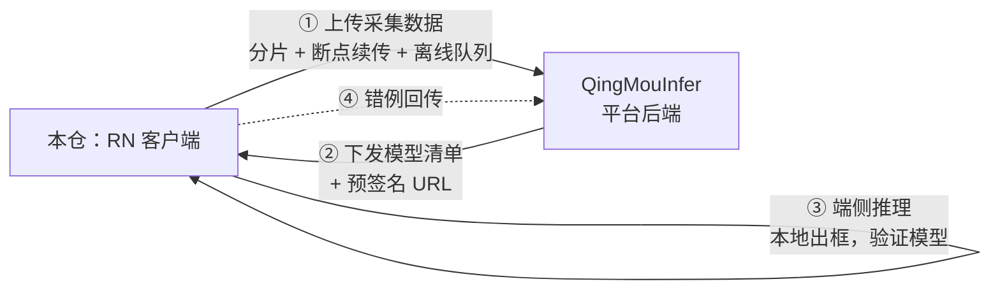

# QingMouCollection · 轻眸识刻采集客户端

> 轻眸识刻的**端侧**：现场采集数据，并在手机上直接测试模型效果。

本仓是 [轻眸识刻](https://github.com/QingMouFoodDate/QingMouPRD) 的 **React Native 客户端**（B 端工具）。
它承担两件事：**把数据采回来**，以及**把训好的模型拿到现场试**。

> C 端消费者应用（微信小程序）在另一个仓：[QingMouMiniProgram](https://github.com/QingMouFoodDate/QingMouMiniProgram)。

---

## 一、在整体架构中的位置



**归属判据**：跑在**手机/平板**上的逻辑属于本仓。

---

## 二、功能范围

### 做（一期）

| 能力 | 说明 |
| :--- | :--- |
| **采集** | 拍照、连拍、录像；采集 SOP 提示（引导框、水平线、距离提示）叠加在预览层 |
| **元数据** | EXIF、GPS、设备型号、拍摄时间随图记录 |
| **上传** | **分片上传 + 断点续传**；**离线队列**（本地库持久化，联网自动补传）；服务端幂等去重 |
| **模型下发** | 从平台拉取模型清单，下载模型文件（带校验），本地缓存与版本管理 |
| **端侧推理测试** | 加载模型、本地推理、画框叠加显示 —— **用于现场验证模型效果，不依赖网络** |
| **错例回传** | 现场发现识别错的样本，一键回传平台进入待标注池 |

### 不做

- ❌ 大批量标注（在手机上标不现实，回 Web 控制台）
- ❌ 训练相关的任何能力
- ❌ C 端消费者功能（属 QingMouMiniProgram）

---

## 三、技术栈

| 层 | 选型 |
| :--- | :--- |
| 框架 | **React Native + TypeScript** |
| 相机 | `react-native-vision-camera` 5.2.3（拍照 / 连拍 / 录像 / 帧处理） |
| 本地存储 | `@op-engineering/op-sqlite` 18.2.5（离线队列的唯一事实源） |
| 绘制 | `@shopify/react-native-skia` 2.14.0（预览叠加、推理结果画框） |
| 端侧推理 | ⚠️ **待定**，见下 |
| 状态管理 | 待定 |

### ⚠️ 端侧推理运行时（未定，需实测后选）

| 候选 | 说明 |
| :--- | :--- |
| `react-native-executorch` 0.10.4 | 维护活跃（2026-09），**内置目标检测**与 YOLO 系列支持，走 PyTorch → ExecuTorch(`.pte`) |
| `react-native-fast-tflite` 3.0.1 | LiteRT/TFLite，体积小、CPU/GPU 后端成熟；需额外产出 TFLite |
| `onnxruntime-react-native` 1.24.3 | 与 QingMouTrain 的 ONNX 导出链路**天然对齐**，无需额外格式 |

**选型约束**：应与 `QingMouTrain` 的导出格式对齐，尽量**只维护一种端侧格式**。
选 `.pte` 则 QingMouTrain 需增加 ExecuTorch 导出；选 ONNX 则与现有导出链路零改动。

### 已排除的方案

- `react-native-background-upload`：**自 2022-10 起停更**，不使用。
  后台上传需自建：op-sqlite 队列 + 系统后台任务（iOS URLSession background / Android WorkManager）。

---

## 四、规划目录结构

```text
QingMouCollection/
├── src/
│   ├── screens/
│   │   ├── Capture/         # 拍摄（含 SOP 引导叠加）
│   │   ├── Upload/          # 上传队列与进度
│   │   ├── ModelTest/       # 端侧推理测试
│   │   └── Settings/
│   ├── features/
│   │   ├── camera/          # VisionCamera 封装
│   │   ├── upload/          # 分片、续传、离线队列
│   │   ├── inference/       # 端侧推理运行时封装（运行时待选）
│   │   └── metadata/        # EXIF / GPS / 设备信息
│   ├── db/                  # op-sqlite schema 与迁移
│   ├── api/                 # 平台 API 客户端
│   └── contracts/           # 与 QingMouInfer 共享的接口类型定义
├── ios/  android/
└── README.md
```

---

## 五、与平台的契约

| 契约 | 权威定义 | 本仓职责 |
| :--- | :--- | :--- |
| **上传链路** | `QingMouInfer`（`UploadSession` / `UploadChunk` / `ManagedFile`） | 只实现客户端，不自造协议 |
| **幂等** | 平台侧 `(size, sha256)` 去重 | 客户端可安全重传，无需自己判重 |
| **模型下发** | `QingMouInfer` 提供清单 + 预签名 URL | 下载、sha256 校验、本地缓存与版本管理 |
| **端侧结果** | 平台零信任端 | 端侧结果**只用于现场参考**，不进入数据集与标注 |

### 两条硬性纪律

1. **离线是主路径，不是异常分支。** 拍摄只写本地库，上传是独立的后台任务；
   现场无网必须能正常拍摄 500 张以上。
2. **端侧模型缓存有配额。** 本地文件有容量上限，模型与待传数据需分别管理，不可互相挤占。

---

## 六、快速开始

```bash
# 依赖：Node 20+、Watchman、Xcode / Android Studio
git clone git@github.com:QingMouFoodDate/QingMouCollection.git
cd QingMouCollection
npm install
npm run ios      # 或 npm run android
```

---

## 七、相关文档

| 文档 | 内容 |
| :--- | :--- |
| [PLAN.md](https://github.com/QingMouFoodDate/QingMouPRD/blob/main/PLAN.md) | 产品形态 + Issue 清单 |
| [REPOS.md](https://github.com/QingMouFoodDate/QingMouPRD/blob/main/REPOS.md) | 仓库地图与跨仓契约 |
| [P0121](https://github.com/QingMouFoodDate/QingMouPRD/blob/main/PRD/08_端接入/P0121_RN客户端接入契约.md) | RN 客户端接入契约（20 个端点） |
| [P0003](https://github.com/QingMouFoodDate/QingMouPRD/blob/main/PRD/01_数据采集/P0003_移动端采集与上传.md) | 移动端采集与上传 |

---

## License

见 [LICENSE](./LICENSE)。
