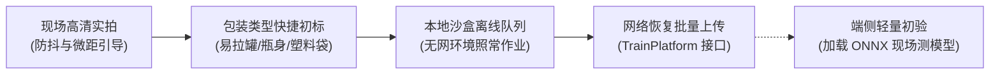

# MobileClient · 轻眸识刻移动端客户端

> **组织归属**：`QingMouFoodDate` GitHub 组织  
> **仓库性质**：面向超市、食堂、现场实地采图、包装元数据快捷初标与端侧推理验证的**移动端 App**  

---

## 📱 一、 核心定位与业务价值

数据是小目标检测与工业 OCR 算法的生命基石。本仓库是深入真实生活实景的**数据采集先锋与端侧试炼场**：



### 核心功能规划
1. **现场高清实拍与取景引导**：
   - 提供相机微距对焦、手持防抖与高光漫反射提示；
   - 拍摄界面提示采图合规准则（参照 [`ProjectPRD/standards/数据采集审核与质量控制规范.md`](https://github.com/QingMouFoodDate/ProjectPRD/blob/main/standards/数据采集审核与质量控制规范.md)）；
2. **包装元数据极速录入**：
   - 拍完后单手可快速勾选包装载体（易拉罐、瓶盖、软包装、纸盒）并选填背面印刷的保质期天数；
3. **离线缓存与批量断点上传**：
   - 地下仓库或超市弱网环境下，照片先完整暂存在手机本地存储；
   - 检测到网络恢复后，自动调用后台任务批量上传，避免因断网遗失拍摄样本；
4. **端侧模型现场验证 (On-Device Test)**：
   - 支持下载轻量化 ONNX 模型，在真实货架前实拍现场看框选精度。

---

## 🏗️ 二、 推荐移动端架构参考

```text
MobileClient/ (推荐目录结构参考)
├── README.md                      # 本说明文档
├── .gitignore                     # 忽略项
└── src/                           # 核心源码
    ├── screens/                   # 【页面层】
    │   ├── CameraScreen           # 现场拍照页（带辅助线、对焦与防抖提示）
    │   ├── MetaInputScreen        # 包装类型与保质期天数快捷标记页
    │   ├── QueueScreen            # 本地离线任务队列与上传状态页
    │   └── TestModelScreen        # 端侧模型测试页
    ├── services/                  # 【服务层】
    │   ├── storage.ts             # 本地离线沙盒存储管理
    │   ├── uploader.ts            # 后台断点续传队列调度器
    │   └── onnx_runner.ts         # 端侧模型加载运行
    ├── components/                # 【组件】取景辅助框、状态胶囊、快速勾选卡片
    └── types/                     # 强类型数据模型
```

---

## 🤝 三、 跨仓契约与质量规范

1. **上传接口规范**：严格对接 [`ProjectPRD/contracts/api_specs.md`](https://github.com/QingMouFoodDate/ProjectPRD/blob/main/contracts/api_specs.md) 中的 `POST /api/v1/samples/batch-upload`；
2. **采图质量准则**：现场采图全员必须遵循 [`ProjectPRD/standards/数据采集审核与质量控制规范.md`](https://github.com/QingMouFoodDate/ProjectPRD/blob/main/standards/数据采集审核与质量控制规范.md)（掌握 4 项生活环境容差，严守 6 大底线红线）。

---

## 🚀 四、 技术选型指南 (留给负责人的自主空间)

- **推荐路线**：
  - `React Native` / `Flutter`（跨平台，一次开发支持 iOS 与 Android）；
  - 或 `Android 原生 (Kotlin + Jetpack CameraX)`（若重点调优相机对焦性能）；
- 移动端负责同学可自由根据擅长技术决断，核心目标是**对焦精准、拍摄流畅、离线上传不丢数据**！

---

## 🏁 五、 阶段完成定义 (Definition of Done, DoD)

- [ ] **阶段 1 (相机调起与保存)**：成功调起手机高分辨率摄像头，拍照并妥善保存在手机本地沙盒；
- [ ] **阶段 2 (上传打通)**：联网时成功调用后端接口将图片及包装元数据上传至后端；
- [ ] **阶段 3 (离线队列)**：断网拍 5 张，联网后自动将 5 张完整同步至服务器。
