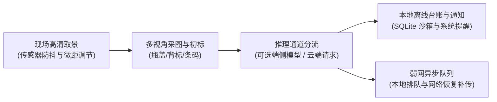

# MobileClient · 轻眸识刻移动端客户端

> **组织归属**：`QingMouFoodDate` GitHub 组织  
> **仓库性质**：面向日常消费与实地场景的 C 端移动应用，兼具原生传感器辅助、本地离线持久化与端侧推理能力探索

---

## 一、 核心定位与业务价值

移动端作为泛在智能终端的重要载体，在优先级上紧随 WebClient 之后，高于 WxClient。其核心价值在于利用智能手机的原生硬件能力，解决现场实拍中的手持抖动、暗光环境与离线作业痛点：



---

## 二、 功能要求与呈现形态

### 1. 相机硬件与传感器辅助
- **运动与合焦双重自检**：结合手机陀螺仪、加速度传感器检测手持稳定性，并结合实时画面的拉普拉斯算子方差检测清晰度，在平稳且对焦清晰的瞬间给予用户拍摄建议；
- **微距变焦与补光控制**：支持微距镜头与高倍率长焦平滑切换，提供常亮闪光灯开关，适应暗光或阴影下的喷码拍摄。

### 2. 端侧轻量模型推理能力预留
- 预留移动端轻量推理引擎运行时接入通道（如 ONNX Runtime Mobile / TFLite / NCNN）；
- **动态分流策略**：在中高端设备且轻量量化模型可用时，支持在脱网环境下直接执行打码检测与初步字符识别；在低算力机型或复杂样本场景下，平滑通过网络请求云端推理节点。

### 3. 本地个人储藏台账与系统通知
- **本地离线台账**：基于设备沙箱数据库（SQLite）持久化存储用户的食品扫描记录，无需联网即可离线查验；
- **系统级定时通知**：基于移动操作系统底层的本地通知与闹钟服务，在食品临近标示到期日前由系统主动发出弹窗提醒，不依赖网络后台长连接服务。

### 4. 弱网任务排队与断点续传
- 在地下商超或信号盲区拍摄的样本及录入的辅助信息，自动保存在本地安全队列中；
- 监听到网络连通后，由后台任务静默完成与业务平台的增量同步。

### 5. 交互呈现形态
- **沉浸式单手取景界面**：全屏相机预览，提供微距瞄准辅助框、镜头倍率切换滑块与常亮手电筒按钮；
- **会话式多图结果页**：卡片式展示已提取的生产日期与保质期，清晰呈现“标示在期内/临期/已超期”及具体的缺失字段引导。

---

## 三、 推荐移动端架构参考

```text
MobileClient/
├── README.md                      # 移动端说明文档与跨平台开发指引
├── pubspec.yaml / package.json    # 移动工程跨端依赖与打包配置文件
└── src/                           # 核心应用源码目录
    ├── screens/                   # 取景拍摄、多图会话与结果展示页面
    ├── services/                  # 网络会话编排、端侧推理与异步同步服务
    ├── native_bridge/             # 相机硬件控制、手电筒与传感器防抖桥接
    ├── components/                # 瞄准辅助框、日期卡片与通用交互组件
    ├── models/                    # 识别会话、机器观察值与台账数据结构
    └── database/                  # 本地离线台账与弱网上传任务队列存储
```

---

## 四、 跨仓契约与交互

- **云端会话协同**：联网状态下通过 HTTP 接口对接 TrainPlatform 会话管理接口，执行多图上传与状态获取；
- **端侧模型拉取**：对接 `GET /api/v1/models/latest` 检查并拉取通过验证的量化模型产物与哈希签名；
- **数据规范**：采集样本严格对齐系统全域数据质量规范要求。

---

## 五、 技术选型参考

### 1. 跨平台多端统一方案
- **路线 A（推荐 · 跨平台性能平衡首选）**：`Flutter (Dart)`
  - *优势*：一套代码编译 Android 与 iOS，自绘渲染引擎性能高，双端相机与传感器插件成熟，底层可通过 FFI 绑定 C++ 推理库；社区针对开源鸿蒙（OpenHarmony）具备持续演进的适配支持。
- **路线 B（国内跨端生态通用）**：`Uni-app x (UTS / Vue 3)`
  - *优势*：全原生编译，对国内安卓生态与纯血鸿蒙 HarmonyOS NEXT 支持迅速，技术门槛相对平缓。
- **路线 C（共享逻辑与原生 UI 结合）**：`Kotlin Multiplatform (KMP 共享数据层与会话逻辑) + 平台原生 UI`
  - *优势*：数据模型、网络请求、会话状态机完全复用，界面层使用各平台原生框架实现。

### 2. 多端分别独立维护方案
- **路线 D（C3 远期储备 · 各平台纯原生独立工程）**：
  - *Android 端*：`Kotlin + Jetpack Compose + CameraX + Room`；
  - *iOS 端*：`Swift + SwiftUI + AVFoundation + CoreData`；
  - *鸿蒙端*：`ArkTS + ArkUI + Camera Kit`；
  - *权衡考量*：各平台分别独立维护可充分调动对应操作系统的原生图像管线与 NPU 加速能力，但对学生团队而言维护成本较高，严格归入远期探索储备。
