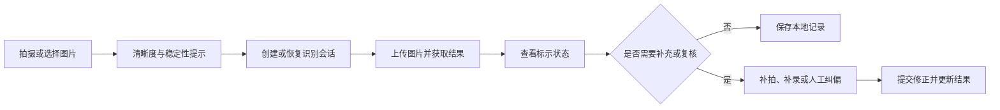

# MobileClient · 轻眸识刻移动端客户端

> 面向日常消费和现场巡检场景的移动端客户端规划

MobileClient 规划覆盖 WebClient 的在线识别、结果展示、证据查看和人工纠偏能力，并在此基础上提供移动设备专属的拍摄辅助、弱网任务、本地记录和端云协同能力。客户端通过统一 HTTP API 对接 `TrainPlatform`；TrainPlatform 编排会话和日期语义推导，Inference Runtime 执行云端模型推理。

## 当前状态

MobileClient 属于移动端扩展方向，当前以产品范围和后续实现规划为主，
不作为 M0 最小闭环的前置依赖。当前仓库主要包含规划文档，不代表已有可运行移动端；具体功能以实际代码、构建和测试记录为准。

---

## 一、产品定位与客户端关系

MobileClient 规划面向以下场景：

- 消费者现场查看食品包装日期；
- 家庭食品整理和期限记录；
- 商超、仓储和巡检人员的移动采集。

它与其他客户端的关系如下：

| 客户端 | 定位 | 主要特点 |
| :--- | :--- | :--- |
| **MobileClient** | 移动端扩展方向 | 规划覆盖 WebClient 在线能力，并增加移动采集、弱网、本地记录和端云协同 |
| **WebClient** | 通用 Web 基础客户端 | 提供跨设备访问的在线识别、证据查看和人工纠偏能力 |
| **WxClient** | 微信生态免安装替代入口 | 面向临时查验、长辈使用和结果分享，不追求覆盖全部移动能力 |

| 能力 | MobileClient 目标职责 | TrainPlatform 目标职责 |
| :--- | :--- | :--- |
| 相机、相册和拍摄引导 | 实现后负责 | 不负责 |
| 清晰度和稳定性提示 | 实现后负责 | 不负责 |
| 会话创建、图片上传 | 调用接口 | 提供接口 |
| 云端检测与 OCR | 展示结果 | 调用 Inference Runtime |
| 日期语义推导 | 展示结果 | 实现后负责计算 |
| 本地会话记录 | 按用户授权保存 | 提供同步能力 |
| 人工纠偏 | 发起提交 | 实现后负责保存并重新决策 |
| 端侧推理 | 可选探索 | 规划模型和回退服务 |

系统输出的是食品包装上的**标示状态**，不替代食品安全检测，也不直接判断食品是否绝对安全或适宜食用。

---

## 二、在线能力与移动端适配

MobileClient 覆盖 WebClient 的在线能力，并针对移动设备调整交互方式：

| 能力 | 移动端要求 |
| :--- | :--- |
| 会话与识别 | 创建、恢复会话，上传一张或多张图片并查看处理状态 |
| 结果与证据 | 查看检测框、OCR、置信度、日期字段、复核状态和多图时间线 |
| 图像辅助 | 查看原图、裁剪图、校正图和增强图，对缺失或低质量区域补拍 |
| 补录与纠偏 | 按 API 契约补录字段、修改文本或检测框，并查看重新计算结果 |
| 数据关系 | 保留机器观察值、结构化证据、人工修正和最终决策的对应关系 |

这些能力与 WebClient 共用会话、结果和纠偏接口；未写入 API 契约的字段或纠偏类型不得提前接入，日期决策规则不在客户端重复实现。

---

## 三、用户流程



---

## 四、功能分级

本仓库不重新定义需求等级；以下章节只说明客户端映射，等级和状态以
[`REQUIREMENTS.md`](https://github.com/QingMouFoodDate/ProjectPRD/blob/main/REQUIREMENTS.md)
中的需求 ID 为准。

### 1. FR-C0-001 至 FR-C0-006：移动端接入目标

- 覆盖上表所列 WebClient 在线能力；
- 调起相机或选择图片；
- 在移动设备上创建、恢复和查看识别会话；
- 展示检测框、OCR 结果、证据详情、标示状态和复核提示；
- 支持补拍、契约已定义的补录、人工纠偏和纠偏后的结果更新；
- 在联网条件下完成云端识别。

### 2. FR-C2-001：移动端增强能力

- 根据传感器和图像清晰度指标提供拍摄辅助；
- 提供瞄准框、变焦和补光等设备控制；
- 支持多角度连续拍摄和补拍任务引导；
- 支持弱网重试、本地会话草稿和上传队列；
- 网络恢复后按用户设置继续同步任务。

具体相机、变焦、补光和传感器能力取决于设备、操作系统和用户权限，不对所有设备作一致性承诺。

### 3. C2/C3 移动端专属探索能力

- 用户授权后的本地食品记录；
- 本地通知和标示期限提醒；
- 弱网任务队列和网络恢复同步；
- 端侧检测与 OCR；
- 端云推理分流和量化模型更新；
- 已有记录的离线查看。

端侧模型不可用、更新失败或设备算力不足时，应回退到云端识别或提示用户稍后重试。

---

## 五、跨客户端能力矩阵

| 能力 | WebClient | MobileClient | WxClient |
| :--- | :---: | :---: | :---: |
| 单图识别 | M0 目标 | 后续规划 | 后续规划 |
| 多图识别会话 | C0 规划 | C0 规划 | 后续规划 |
| 检测框、OCR 和置信度查看 | C0 规划 | C0 规划 | 结果摘要规划 |
| 局部图像和证据查看 | C0 规划 | C0 规划 | 结果摘要规划 |
| 人工纠偏 | C0 规划 | C0 规划 | 后续规划 |
| 相机实时取景辅助 | 后续规划 | 后续规划 | 受微信能力限制 |
| 传感器稳定性提示 | 后续规划 | 后续规划 | 非核心能力 |
| 弱网任务队列 | 后续规划 | 后续规划 | 仅规划重试 |
| 本地会话记录 | 后续规划 | 后续规划 | 后续规划 |
| 食品台账和期限提醒 | 非核心能力 | 后续规划 | 后续规划 |
| 端侧模型推理 | 非核心能力 | C3 探索 | 非核心能力 |
| 免安装使用 | 非目标 | 非目标 | 后续规划 |
| 微信分享 | 后续规划 | 后续规划 | 后续规划 |

矩阵描述客户端的产品能力边界，不代表所有设备、系统版本或运行环境都具备相同实现条件。

---

## 六、移动端增强模块

### 1. 拍摄辅助

移动端可结合以下信息提供拍摄提示：

- 陀螺仪和加速度数据，用于判断手持稳定性；
- 图像清晰度指标，用于提示重新对焦；
- 相机预览，用于引导用户对准瓶盖、封口或罐底等区域；
- 设备提供的变焦、闪光灯和微距能力。

拍摄辅助只提供建议，不应阻止用户保存或提交图片。设备不支持传感器、摄像头能力或相关权限被拒绝时，应提供手动选图等替代路径。

---

### 2. 本地记录、弱网与通知

在用户授权后，客户端可以保存会话摘要、识别结果和用户确认的标示日期。具体存储实现可采用 SQLite、Room、Core Data 或跨平台数据库；本地记录不改变服务端决策结果。

上传任务至少区分以下状态：

```text
PENDING
UPLOADING
SUCCEEDED
FAILED
RETRY_REQUIRED
```

网络恢复后是否自动上传由用户设置决定。失败任务不得静默丢失，应支持查看、重试和删除，并使用幂等标识避免重复创建会话。

通知只能依据服务端返回且经用户确认的标示日期创建。信息缺失、证据冲突或低置信度时，不创建确定性期限提醒。用户可以关闭通知，通知内容不构成食品安全结论。

---

## 八、云端接口与端侧模型

联网时通过以下接口与 `TrainPlatform` 协作：

- 创建会话：`POST /api/v1/sessions`
- 上传图片并执行增量识别：`POST /api/v1/sessions/{session_id}/images`
- 获取会话结果：`GET /api/v1/sessions/{session_id}`
- 提交人工纠偏：`POST /api/v1/sessions/{session_id}/correction`
- 查询最新模型元数据：`GET /api/v1/models/latest`

端侧模型接入需满足：

- 下载前检查版本、设备能力和模型兼容性；
- 下载后校验服务端返回的 SHA-256；
- 保留可用的旧模型，更新失败时不覆盖；
- 推理异常或置信度不足时回退云端；
- 不在客户端重复实现日期决策规则。

接口字段、响应结构、错误码和状态枚举以 [`ProjectPRD/contracts/API.md`](https://github.com/QingMouFoodDate/ProjectPRD/blob/main/contracts/API.md) 和 [`ProjectPRD/contracts/MODEL.md`](https://github.com/QingMouFoodDate/ProjectPRD/blob/main/contracts/MODEL.md) 为准。

---

## 九、提议工程结构

以下目录是实现建议，不代表当前仓库已经具备对应文件。

```text
MobileClient/
├── README.md                      # 移动端说明与开发约定
├── pubspec.yaml / package.json    # 跨平台工程依赖
└── src/
    ├── screens/                   # 拍摄、会话和结果页面
    ├── services/                  # 网络、推理和同步服务
    ├── native_bridge/             # 相机、传感器和通知桥接
    ├── components/                # 瞄准框、日期卡片和通用组件
    ├── models/                    # 会话、观察值和台账模型
    └── database/                  # 本地记录和任务队列
```

---

## 十、技术选型

候选路线包括 Flutter、Uni-app x、Kotlin Multiplatform 和多端原生。最终选择取决于目标平台、相机/传感器能力、团队经验和维护成本；无论采用哪条路线，都必须保持统一 API、数据模型、权限边界和云端回退能力。

---

## 十一、权限、隐私与安全

- 按需申请相机、相册、传感器、通知和后台任务权限；
- 未授权时提供手动选图、关闭通知等替代路径；
- 本地图片、会话记录和待同步任务由用户控制；
- 支持清理本地图片、缓存、模型和失败任务；
- 上传、查询、纠偏和模型下载使用 HTTPS；
- 前端日志不得记录原始图片、完整识别文本或其他不必要的敏感信息；
- 端侧模型和缓存不应绕过系统权限或服务端访问控制。

---

## 十二、相关文档

- [系统需求](https://github.com/QingMouFoodDate/ProjectPRD/blob/main/REQUIREMENTS.md)
- [系统架构](https://github.com/QingMouFoodDate/ProjectPRD/blob/main/ARCHITECTURE.md)
- [API 接口契约](https://github.com/QingMouFoodDate/ProjectPRD/blob/main/contracts/API.md)
- [数据模型](https://github.com/QingMouFoodDate/ProjectPRD/blob/main/contracts/DATA.md)
- [模型交付规约](https://github.com/QingMouFoodDate/ProjectPRD/blob/main/contracts/MODEL.md)
