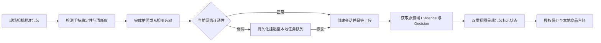

# MobileClient · 轻眸识刻移动端客户端

> 面向日常消费和现场巡检场景的移动端客户端规划与体验延伸
>
> **工程状态**：移动端产品与交互设计储备 · M0 优先验证 Web 核心链路 · 统一接入 InferPlatform 业务网关

MobileClient 规划复用 WebClient 在线能力，并提供移动端手持拍摄辅助、弱网任务队列、本地食品台账与端云协同。通过 RESTful API 对接 InferPlatform 在线中枢，不直连底层数据库或模型文件。

---

## 工程状态与阶段说明

MobileClient 属于移动端体验扩展方向，当前以产品架构、交互原型与原生硬件适配规划为主，不作为 M0 最小闭环的前置依赖。本仓库维护移动端工程规范，优先保障 Web 端完成端到端闭环验证，具体实现随后续阶段递进展开。

---

## 一、产品定位与客户端关系

MobileClient 规划面向以下典型场景：

- **消费者现场查看**：在货架前单手持机快速对准包装核验日期；
- **家庭食品整理**：整理冰箱与储藏室时批量拍摄录入食品台账；
- **商超仓储巡检**：巡检人员移动作业，在弱网或离线环境下登记临期商品。

协同分工如下：

| 客户端名称 | 架构定位 | 主要特点与协同分工 |
| :--- | :--- | :--- |
| **MobileClient** | 移动端扩展方向 | 规划覆盖 WebClient 在线能力，增加移动采集、弱网队列与本地台账 |
| **WebClient** | 通用 Web 基础客户端 | 桌面大屏基准入口，提供原图覆层与字段卡片双重视图呈现 |
| **WxClient** | 微信生态免安装入口 | 面向临时轻量查验与长辈大字模式，不追求覆盖全部重型移动能力 |

| 核心能力单元 | MobileClient 目标职责 | InferPlatform 目标职责 |
| :--- | :--- | :--- |
| 相机、相册与传感器引导 | 客户端负责实现 | 不负责底层硬件 |
| 清晰度与手持稳态检测 | 客户端计算提示 | 不负责物理传感器 |
| 会话创建与图片上传 | 携带幂等键发起调用 | 提供统一 API 网关 |
| 云端小目标检测与 OCR | 接收 Observation 呈现 | 调用内部 Inference Runtime |
| 日期语义推导与决策 | 接收 Decision 展示 | 依据上位日期规则执行计算 |
| 本地离线食品台账 | 按用户授权持久化保存 | 提供数据同步支撑 |
| 字段级人工纠偏 | 发起纠偏请求并刷新界面 | 保存纠偏记录并即时重算决策 |
| 边缘轻量推理探索 | 规划端侧离线模型适配 | 维护候选模型元数据 |

系统输出限定为食品包装上的**标示状态**，不替代食品安全检测，不直接判断食品是否绝对可食用。

---

## 二、移动端交互主流程



---

## 三、功能分级与能力演进

### 1. 移动端基础接入目标

- 复用上位契约的在线查验会话，支持单张图像上传与处理状态感知；
- 支持原图边界框覆层与双维度标示状态卡片呈现；
- 支持字段级人工纠偏并即时同步业务推导结果。

### 2. 移动端原生增强能力

- **手持稳态辅助**：融合加速度计与陀螺仪数据，在手持剧烈晃动时提示稳拿；
- **智能取景引导**：提供微距变焦提示与反光预警，辅助对准日期喷码；
- **弱网任务队列**：弱网场景下本地持久化排队，网络恢复后自动提交；
- **本地食品台账**：将历史查验结论加密归档，支持系统本地到期提醒。

### 3. C2 与 C3 移动端专属探索能力

- 评估在移动芯片（NPU/GPU）上运行轻量化端侧量化模型的可行性，作为弱网环境下的初筛辅助手段。

---

## 四、跨客户端能力矩阵

| 核心能力特性 | WebClient 通用端 | MobileClient 移动端 | WxClient 小程序端 |
| :--- | :---: | :---: | :---: |
| 跨平台桌面浏览器访问 | 核心支持 | 响应式兼容 | 不支持 |
| 现场手持微抖态检测 | 不支持 | 核心规划 | 不支持 |
| 弱网离线持久化任务队列 | 不支持 | 核心规划 | 不支持 |
| 原图覆层与字段卡片双重视图 | 核心支持 | 紧凑布局支持 | 极简模式支持 |
| 长辈大字关怀模式 | 可选高对比度 | 支持系统字体缩放 | 核心深度定制 |
| 家庭社交卡片分享 | 不支持 | 系统分享组件 | 微信原生卡片分享 |
| 字段级人工纠偏流转 | 核心支持 | 核心支持 | 基础表单支持 |

---

## 五、上位接口契约映射

移动端在线交互完全复用 InferPlatform 提供的标准 API 契约：

| 接口端点与方法 | 功能职责说明 |
| :--- | :--- |
| `POST /api/v1/sessions` | 初始化移动识别会话，获取短期透明凭据 `session_token` |
| `POST /api/v1/sessions/{session_id}/images` | 结合 `Idempotency-Key` 幂等上传图片，触发服务端推理流水线 |
| `GET /api/v1/sessions/{session_id}` | 获取包含完整版本化 Observation、Evidence 与 Decision 的安全 DTO |
| `POST /api/v1/sessions/{session_id}/correction` | 提交包装日期或保质期人工修正（C0 阶段） |
| `GET /api/v1/models/latest` | 查询最新端侧候选轻量化模型元数据（C3 远期探索） |

---

## 六、提议工程目录结构

```text
MobileClient/                      # 移动端客户端仓库
├── README.md                      # 移动端定位与契约指引
├── pubspec.yaml                   # 移动端跨平台依赖配置文件
└── src/                           # 移动端源码核心目录
    ├── screens/                   # 拍摄查验与结果呈现页面
    ├── services/                  # 在线 API 通信与任务调度
    ├── native_bridge/             # 设备传感器与系统权限适配
    ├── components/                # 动态瞄准框与状态通用组件
    ├── models/                    # 数据传输对象与实体结构
    ├── secure_storage/            # 会话凭证安全隔离与清理
    └── database/                  # 本地离线台账与持久化队列
```

---

## 七、权威依据与参考文档

- **系统设计与规划**：[ProjectPRD/REQUIREMENTS.md](../ProjectPRD/REQUIREMENTS.md) · [ProjectPRD/ARCHITECTURE.md](../ProjectPRD/ARCHITECTURE.md) · [ProjectPRD/ROADMAP.md](../ProjectPRD/ROADMAP.md)
- **跨仓技术契约**：[contracts/API.md](../ProjectPRD/contracts/API.md) · [contracts/DATA.md](../ProjectPRD/contracts/DATA.md) · [contracts/openapi.json](../ProjectPRD/contracts/openapi.json)
- **规则与决策记录**：[contracts/DATE_RULES.md](../ProjectPRD/contracts/DATE_RULES.md) · [decisions/ADR-001-REPOSITORY_BOUNDARIES.md](../ProjectPRD/decisions/ADR-001-REPOSITORY_BOUNDARIES.md)
- **工程与质量规范**：[standards/ENGINEERING.md](../ProjectPRD/standards/ENGINEERING.md)
