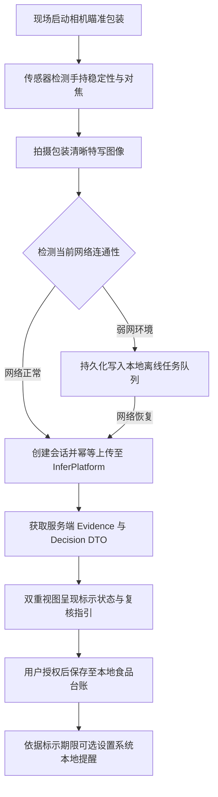

# MobileClient · 轻眸识刻移动端客户端

> 前瞻性移动体验与传感器辅助设计储备，面向现场拍摄、手持防抖与离线食品台账
>
> **工程状态**：移动端产品与交互设计储备 · M0 优先验证 Web 核心链路 · 统一接入 InferPlatform 业务网关

MobileClient 专注于轻眸识刻系统在手持移动终端与现场查验场景的体验延伸。系统规划在 Web 核心在线查验能力的基础上，充分发挥移动设备硬件特性，引入手持稳态检测、微距对焦引导、弱网离线任务队列与本地食品台账功能；所有在线业务请求与推理能力统一接入 InferPlatform。

---

## 工程状态与边界说明

- **当前阶段**：系统处于架构规范与 M0 核心原型攻坚阶段，当前阶段优先推进 Web 核心主链路验证，本仓作为移动端设计储备同步演进；
- **实现范围**：M0 阶段聚焦产品原型定义与原生传感器适配方案设计；端侧轻量化模型推理（FR-C3-001）属于远期演进探索，不作为当前交付约束；
- **契约基准**：数据交互与通信规约严格绑定上位 [API.md](../ProjectPRD/contracts/API.md)、[DATA.md](../ProjectPRD/contracts/DATA.md) 与 [openapi.json](../ProjectPRD/contracts/openapi.json)。

---

## 一、核心定位与移动端特色

### 1. 核心负责内容

- **现场拍摄辅助**：利用设备陀螺仪与加速度传感器感知手持微抖态，结合局部模糊度检测提供实时对焦与平稳握持指引；
- **动态瞄准引导**：提供针对包装局部喷码的智能瞄准框、微距变焦提示与补光引导，提升首拍成像质量；
- **弱网任务队列**：在商超地库或弱网环境下，支持本地拍摄任务持久化挂起，待网络恢复后自动触发幂等重试；
- **本地食品台账**：支持在用户授权下保存必要的查验记录与标示结论，提供到期日程提醒的本地化配置能力。

### 2. 系统协作与设计约束

- **在线中枢解耦**：不直接访问底层数据库或离线模型文件，所有会话创建、图像分析与语义推导统一托管至 InferPlatform；
- **法定标示受限**：系统严格推导并呈现食品包装标示状态，不替代食品安全检测，界面严禁给出食品绝对可食用等卫生保证；
- **端侧探索中立**：远期端侧轻量化模型仅作为弱网环境下的候选观察辅助，最终决策与证据链条仍以服务端权威输出为准。

---

## 二、移动端交互主流程架构



---

## 三、原生能力与用户体验设计

1. **传感器稳态感知**：通过设备原生传感器计算实时角速度与重力矢量变化，在手持剧烈晃动或光照不足时给出友好提示，从源头降低运动模糊对 OCR 的干扰。
2. **离线任务生命周期**：本地队列严格保留每一次请求的 `Idempotency-Key` 与原始图像指纹，避免弱网重试时产生重复服务端资源；用户可随时手动管理、重试或清理挂起任务。
3. **本地隐私台账**：本地食品记录以受控 SQLite 或加密键值对存储，不上传未获授权的个人相册信息；台账清晰标注缓存时间，不伪造服务端最新状态。

---

## 四、上位接口契约映射

移动端在线交互完全复用 InferPlatform 提供的标准 API 契约：

| 功能模块 | 对应接口与方法 | 职责说明 |
| :--- | :--- | :--- |
| **会话管理** | `POST /api/v1/sessions` | 初始化移动查验会话，获取受控临时凭据 |
| **图像上传** | `POST /api/v1/sessions/{session_id}/images` | 结合幂等键上传清晰图像，获取流水线处理结果 |
| **结果同步** | `GET /api/v1/sessions/{session_id}` | 轮询或拉取完整版本化安全 DTO |
| **字段纠偏** | `POST /api/v1/sessions/{session_id}/correction` | 提交包装日期或保质期人工修正（C0 阶段） |
| **端侧探索** | `GET /api/v1/models/latest` | 查询最新端侧候选轻量化模型元数据（C3 远期探索） |

---

## 五、提议工程目录结构

以下为移动端客户端仓库的建议目录布局，遵循现代移动跨平台架构规范：

```text
MobileClient/                      # 移动端客户端仓库
├── README.md                      # 移动端定位与契约指引
├── pubspec.yaml                   # 移动端跨平台依赖配置文件
└── src/                           # 移动端源码核心目录
    ├── screens/                   # 拍摄查验与结果呈现页面
    ├── services/                  # 在线 API 通信与任务调度
    ├── native_bridge/             # 设备传感器与系统权限适配
    ├── components/                # 动态瞄准框与状态通用组件
    ├── models/                    # 数据传输对象与实体结构
    ├── secure_storage/            # 会话凭证安全隔离与清理
    └── database/                  # 本地离线台账与持久化队列
```

---

## 六、权威依据与参考文档

- **系统设计与规划**：[ProjectPRD/REQUIREMENTS.md](../ProjectPRD/REQUIREMENTS.md) · [ProjectPRD/ARCHITECTURE.md](../ProjectPRD/ARCHITECTURE.md) · [ProjectPRD/ROADMAP.md](../ProjectPRD/ROADMAP.md)
- **跨仓技术契约**：[contracts/API.md](../ProjectPRD/contracts/API.md) · [contracts/DATA.md](../ProjectPRD/contracts/DATA.md) · [contracts/openapi.json](../ProjectPRD/contracts/openapi.json)
- **规则与决策记录**：[contracts/DATE_RULES.md](../ProjectPRD/contracts/DATE_RULES.md) · [decisions/ADR-001-REPOSITORY_BOUNDARIES.md](../ProjectPRD/decisions/ADR-001-REPOSITORY_BOUNDARIES.md)
- **工程与质量规范**：[standards/ENGINEERING.md](../ProjectPRD/standards/ENGINEERING.md)
