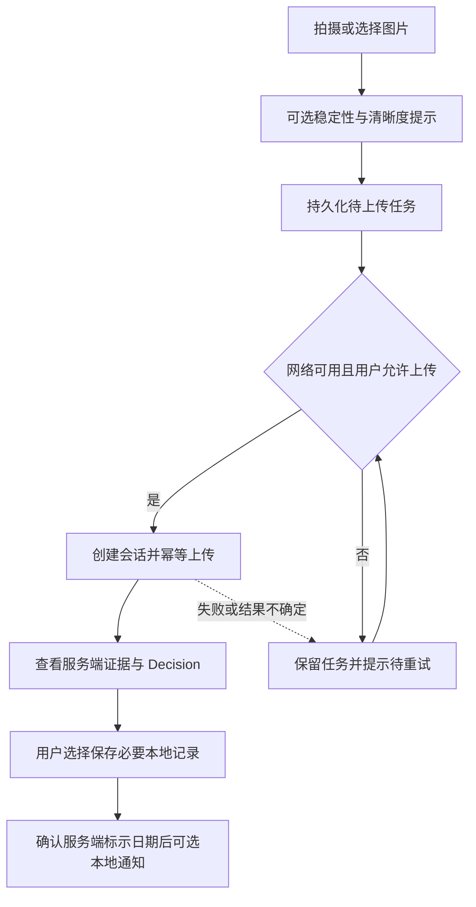

# MobileClient · 轻眸识刻移动端客户端

> 后续移动端规划，工程暂缓；不是 M0 前置依赖，也不是已运行客户端。

MobileClient 规划在 Web 在线查验能力基础上，增加现场拍摄辅助、弱网任务、本地记录与通知。所有业务 API 接入 `InferPlatform`，由平台编排会话、聚合证据并生成 Decision，内部 Inference Runtime 执行检测与 OCR；客户端不直接访问 TrainPlatform、数据库或服务端模型文件。

当前主要是产品与模块设计，不能证明代码、构建、测试、部署或模型已交付。Web 的 M0 单图闭环也待实现；多图、完整展示与人工纠偏属于 C0 后续，不能因“覆盖 Web”而承诺这些功能已经可用。

## 一、范围与需求映射

- **FR-C2-001（后续候选、工程暂缓）**：相机与传感器拍摄辅助、弱网任务队列、本地食品记录和用户授权的本地通知。
- **C0 接入目标（后续规划）**：复用 FR-C0-005/006 的会话展示与契约内纠偏，消费 FR-C0-002 至 004 的服务端输出；FR-C0-001 是训练/评测数据准入，不是普通拍照上传职责。多图属于 C0，不重分类为移动端 C2。
- **FR-C3-001（远期探索）**：量化模型与端侧推理评估，需具备授权数据、合规模型来源、可用模型产物、目标设备与实际验证条件，不能脱离这些前提承诺离线识别或性能。

项目保持 **8 仓：7 个项目仓 + `.github` 组织配置仓**。Inference Runtime 是 InferPlatform 内部逻辑模块，不是第 9 仓。MobileClient、WxClient 的工程暂缓不影响优先验证 Web M0；跨端授权、同步与继续处理的任务契约尚未实现，不承诺无缝迁移会话。

系统只呈现食品包装**标示状态**，不作食品安全或可食用保证，不把性能目标写成实测能力。

## 二、规划路径与移动端模块



上述是后续交互目标，不代表后台持续执行、同步或通知已经实现。

### 拍摄辅助

- 结合陀螺仪、加速度与图像清晰度提示手持稳定性和重新对焦；仅作辅助，不伪造识别结果。
- 规划瞄准框、变焦、补光与微距引导，实际可用性由设备、操作系统和权限决定。
- 不支持传感器、相机权限拒绝或拍摄辅助失败时，保留相册选择/手动拍摄路径，不以稳定性评分强制阻止提交。
- 多角度补拍接入 C0 多图契约后再实现，不将其作为 M0 依赖。

### 弱网任务与本地记录

以下仅为提议的本地 UX/任务状态，不新增服务端枚举：

```text
PENDING -> CREATING_SESSION -> UPLOADING -> PROCESSING -> SUCCEEDED
网络不可用 -> WAITING_NETWORK
超时或结果不确定 -> RETRY_REQUIRED
明确失败 -> FAILED
```

- 上传前持久化任务、必要图片引用、请求和幂等键；同一创建/上传/纠偏操作重试复用同一个 `Idempotency-Key`，不重复创建资源。
- 网络恢复后按用户设置继续；失败、应用中断或结果不确定时不静默丢失任务，提供查看、重试、取消与删除入口。
- 只有 HTTP 和业务响应均成功才标为成功；超时保留待确认状态，按契约重试或查询确认，不猜测完成。
- 本地记录按用户授权保存必要的服务端结果与版本、来源；离线查看明确标出缓存时间，不冒充最新服务端决策。不依赖尚未定义的跨端同步或摘要 API。
- 用户可清理本地图片、记录与任务；系统后台限制、断网或权限撤销时明确提示，不保证任务持续运行。

### 本地通知

只依据**服务端返回且经用户确认的标示日期**安排用户授权的本地通知；信息缺失、证据冲突或低置信度时不创建确定性期限提醒。服务端 Decision 更新后需重新确认并处理旧提醒。通知被关闭或系统抑制时不保证送达；不重算日期规则、临期状态或剩余天数来改变业务结果。服务端订阅与跨端提醒任务契约尚未实现，不承诺云端提醒或多端同步。

## 三、结果、纠偏与错误边界

平台返回完整、版本化 Observation、Evidence、Decision **安全 DTO**，客户端展示检测框、OCR、证据关联、服务端日期与状态，不访问内部路径或凭证。机器 Observation 来自 Runtime，不由客户端提交或改写；端侧探索结果也不能冒充这份服务端机器结果。界面可以简化，但服务端摘要响应需未来单独契约。

- 标示状态统一为：在期 `WITHIN_MARKED_PERIOD`、临期 `NEAR_EXPIRY`、超期 `PAST_MARKED_PERIOD`、无法判定 `UNDETERMINED`。
- 复核状态统一为：证据完备 `EVIDENCE_COMPLETE`、信息缺失 `INFORMATION_MISSING`、证据冲突 `EVIDENCE_CONFLICT`、低置信度 `LOW_CONFIDENCE`。
- 两种状态独立展示，结合文字、图标与颜色。**推理失败不是 `UNDETERMINED`**，网络/推理失败不显示 success 或伪造业务结果。
- 客户端不推导到期日、临期阈值或重算业务结果；保存条件等包装说明只是条件提示。
- 原图裁剪、校正、增强、OCR 输入图等 `variants` 为后续可选对照，不能假定当前 API 已提供对应字段或地址。

C0 纠偏待实现：当前 `correction.v1` 允许 `mfg_date`、`exp_date`、`shelf_life`（`value` + `unit`，单位 `DAY` / `MONTH` / `YEAR`）及 `storage_condition`；原始 OCR 文本与检测框修正仍在规划，尚未在 v1 定义，不能宣称可提交。合法纠偏接受后立即更新当前 Decision，失败时保留输入但不显示成功；训练候选另需 TrainPlatform 质量审核，不直接更新线上模型。

图片格式/大小/质量错误、会话或令牌失效、上传失败、推理超时和存储空间不足应给出具体下一步。证据缺失或冲突是复核提示，不等同于基础设施失败。

## 四、InferPlatform 接口与端侧探索

以下是契约接入目标，不代表 API 或客户端已经上线：

| 阶段 | 方法与路径 | 用途 |
| :--- | :--- | :--- |
| 后续在线接入 | `POST /api/v1/sessions` | 创建会话，返回 `session_id`、`session_token` |
| 后续在线接入 | `POST /api/v1/sessions/{session_id}/images` | 上传图片并获取平台处理结果 |
| 后续在线接入 | `GET /api/v1/sessions/{session_id}` | 获取完整版本化安全 DTO |
| C0 后续接入 | `POST /api/v1/sessions/{session_id}/correction` | 提交契约内纠偏 |
| C3 仅 Mobile | `GET /api/v1/models/latest` | 查询端侧模型元数据，非在线识别前置条件 |

创建后的会话请求使用 `Authorization: Bearer <session_token>`；写操作携带 `Idempotency-Key`，新操作使用新键。生产使用 HTTPS，令牌采用平台安全存储与受控生命周期，不分享、不写日志、不放 URL，不以令牌绕过访问控制。模型访问鉴权和下载按 API/MODEL 契约，不自行假定会话令牌可访问所有模型。

端侧探索需验证模型版本、设备/运行时兼容性、授权和 SHA-256；保留可用旧模型，失败不覆盖。设备算力不足、模型不可用、推理异常或需复核时，用户允许且联网后回退云端，否则保留任务并提示稍后重试。端侧只提供探索性的候选观察或离线辅助，不能替代统一 Evidence/Decision；候选提交协议未定义前，不向在线接口提交 Observation。性能与精度结论必须来自授权数据和目标设备实测。

## 五、设备权限、隐私与可访问性

- 按需说明并申请相机、相册、传感器、通知与后台任务相关权限，尊重系统及用户设置，不保证所有设备提供相同能力。
- 权限被拒绝时提供手动选图、关闭通知、手动重试等替代路径；模型或网络失败不阻断已授权本地记录的查看。
- 上传前说明用途与契约限制；本地图片、记录、待同步任务、缓存和模型均可由用户清理，令牌不混入可导出记录。
- 日志不记录原始图片、完整 OCR、令牌或不必要的个人信息；端侧缓存与模型不能绕过权限和服务端访问控制。
- 状态卡片支持大字、高对比度和文字图标，拍摄、重试与通知设置保持清晰可操作。

## 六、提议工程结构与技术候选

以下为逐行注释的建议结构，不代表当前存在相应工程：

```text
MobileClient/                      # 移动端规划仓库
├── README.md                      # 阶段、模块与契约入口
├── pubspec.yaml / package.json    # 按最终框架选择依赖文件，并非同时必需
└── src/                           # 客户端源码（按框架调整）
    ├── screens/                   # 拍摄、任务、结果与本地记录页面
    ├── services/                  # API 鉴权、幂等上传与 C3 推理适配
    ├── native_bridge/             # 相机、传感器、权限和本地通知桥接
    ├── components/                # 拍摄引导与统一状态卡片
    ├── models/                    # 版本化 DTO、用户记录与任务类型
    ├── secure_storage/            # 会话令牌的安全存取与清理
    └── database/                  # 授权本地记录、图片引用及持久任务队列
```

Flutter、Uni-app x、Kotlin Multiplatform 或多端原生均为候选，按目标设备、相机/传感器能力和维护成本选型；本地数据库方案随框架确定，不作现成实现承诺。

## 七、事实源与相关文档

统一以 [ProjectPRD README](https://github.com/QingMouFoodDate/ProjectPRD/blob/main/README.md)、[REQUIREMENTS](https://github.com/QingMouFoodDate/ProjectPRD/blob/main/REQUIREMENTS.md)、[ARCHITECTURE](https://github.com/QingMouFoodDate/ProjectPRD/blob/main/ARCHITECTURE.md) 为产品与职责依据；以 [API](https://github.com/QingMouFoodDate/ProjectPRD/blob/main/contracts/API.md)、[DATA](https://github.com/QingMouFoodDate/ProjectPRD/blob/main/contracts/DATA.md)、[DATE_RULES](https://github.com/QingMouFoodDate/ProjectPRD/blob/main/contracts/DATE_RULES.md)、[MODEL](https://github.com/QingMouFoodDate/ProjectPRD/blob/main/contracts/MODEL.md)、[TRAINING](https://github.com/QingMouFoodDate/ProjectPRD/blob/main/contracts/TRAINING.md) 为契约依据；仓库边界见 [ADR-001](https://github.com/QingMouFoodDate/ProjectPRD/blob/main/decisions/ADR-001-REPOSITORY_BOUNDARIES.md)。

DATE_RULES、TRAINING、ADR-001、OpenAPI 与四份 JSON Schema 已纳入 ProjectPRD，均仍为候选或设计依据；本仓只引用，不重复定义。当前 GitHub 仓库为 private，链接需要相应访问权限，不保证所有访客可访问；规划与契约不等同于已交付能力。
